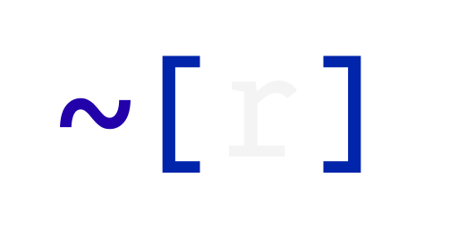
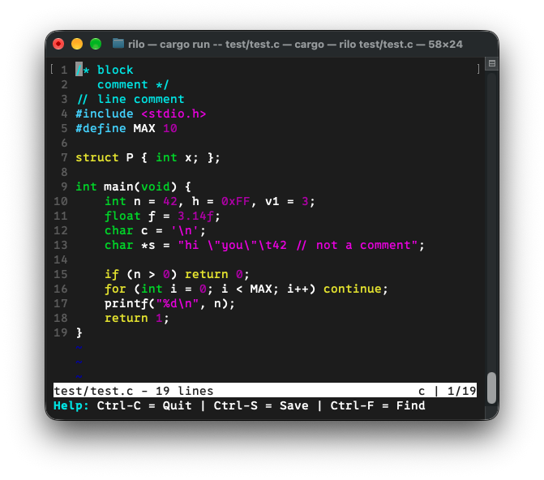
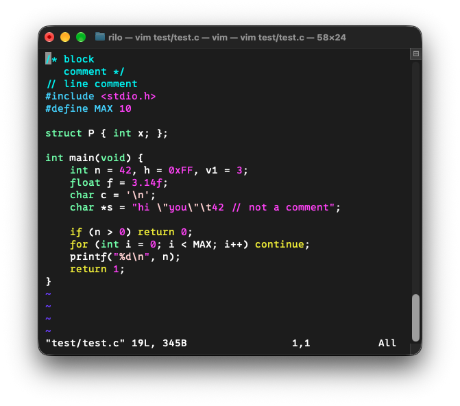
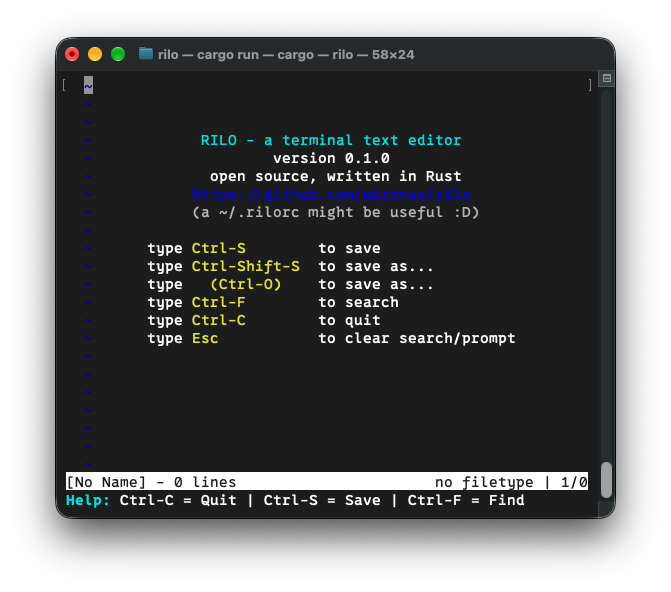
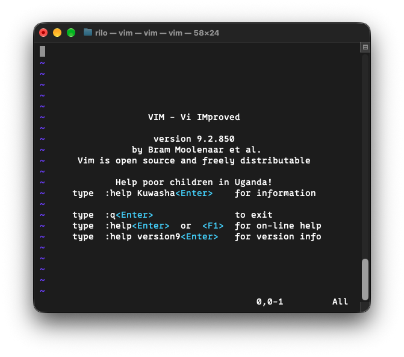
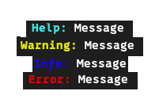

<p align="center">
    
    <h1 align="center">rilo</h1>
</p>

<p align="center">
    
    
    
    
    
    
    <br />
    A code editor in the terminal
</p>

## Why does rilo even exist ( °ヮ° ) ?

I created rilo because i've seen this guide : [kilo](https://viewsourcecode.org/snaptoken/kilo/) but it was in C and with some little functionality i was good with (like the PageUp/PageDown thing), so i recreated it in rust with some new functionality.

## Images

<table>
  <tr>
    <td align="center">
      <br>
      <sub><b>C code (rilo)</b></sub>
    </td>
    <td colspan="4" align="center">
      <br>
      <sub><b>C code (vim)</b></sub>
    </td>
  </tr>
</table>

<table>
  <tr>
    <td align="center">
      <br>
      <sub><b>Home screen (rilo)</b></sub>
    </td>
    <td colspan="4" align="center">
      <br>
      <sub><b>Home screen (vim)</b></sub>
    </td>
  </tr>

  <tr>
    <td colspan="2" align="center">
      <br>
      <sub><b>Message</b></sub>
    </td>
  </tr>
</table>

## Core Features ( ദ്ദി ˙ᗜ˙ )

* **Message bar:** can show Warning, Error, Help and Info (with **color** !)
  * Every message is **gone** after **3 sec**
* **Status bar**: show the **filename**, the **total number of line**, the **filetype** (for highlighting) and the **current line**
  * **(modified)** flag when there is unsaved changes + warning when quit with unsaved changes
* **Highlight syntax**
* **Save**
* **Save as**
* **Same color as vim**
* **Use `queue!()` (from crossterm) for less/no flicker**
* **Hexadecimal number support**
* **`#define` and `#include` support (in c)**
* **`~/.rilorc`:** you can change differents settings like `TAB_STOP`, `QUIT_TIMES`, `AUTO_INDENT` and `SHOW_LINES_NUMBER`
* **Auto-indent**
* **Search with match highlighting**
* **Welcome Screen**: with the version, github link and keybinds
* **Line number**: can be removed with `~/.rilorc`

* **Supported Languages:** C/C++ (`.c` `.h` `.cpp`), Rust (`.rs`) and Python (`.py`)

### `~/.rilorc`

In it you can change differents settings like `TAB_STOP`, `QUIT_TIMES`, `AUTO_INDENT` and `SHOW_LINES_NUMBER`. I built a custom parser to get those settings into the editor.

Here is an example:

```
TAB_STOP=4
QUIT_TIMES=1
SHOW_LINES_NUMBER=true
AUTO_INDENT=true
```

`QUIT_TIMES` is how many extra Ctrl-C presses are needed to quit with unsaved changes (default 1, so two presses in total).

`#` at the start of the line comment the option out

### Keybinds

| Key | Action |
|-----|--------|
| Arrow | Move around |
| Ctrl-C | Quit |
| Ctrl-F | Search |
| Ctrl-S | Save |
| Ctrl-Shift-S[*](#other) (or Ctrl-O) | Save as... |
| Ctrl-A / Ctrl-D | Go to start / end of line |
| Ctrl-W / Ctrl-X | Page up / page down |
| Down/Right (when search) | Go the next occurrence  |
| Up/Left (when search) | Go the previous occurrence  |
| Esc | Quit prompt / clear search |


## Built with...

* [Rust](https://rust-lang.org/): for the whole app! `ദ്ദി(˵ •̀ ᴗ - ˵ ) ✧`
* [crossterm](https://crates.io/crates/crossterm): for the cross-platform UI

## Installation & Quick Start

The easiest way to get **rilo** is to run :
```bash
cargo install rilo
```
to get the latest version `( ദ്ദി ˙ᗜ˙ )`. (Otherwise you can build the project from source on your own here: [Development](#development))

`ദ്ദി(˵ •̀ ᴗ - ˵ ) ✧`

## Development

> [!IMPORTANT]
> You must have [Rust](https://rust-lang.org/) and [Cargo](https://doc.rust-lang.org/cargo/) installed on your computer

### Building rilo from source

* Clone the repository with

```bash
git clone https://github.com/wirenux/rilo.git
cd rilo
```

* Then install the dependencies and run the program with:

```bash
cargo run
```

## Usage

```bash
rilo file.c     # open a file
rilo            # empty buffer, Ctrl-S to save as..
```

## Boring Stuff

### Use of AI

I used AI only to generate `test` code in C, Python and Rust, to test the highlighting of the syntax. All generated code are in the [`test/`](https://github.com/wirenux/rilo/tree/main/test) folder.

Everything else is built on my own.

### Credits

This project is created by [@wirenux](https://github.com/wirenux) in [Rust](https://rust-lang.org/), using [crossterm](https://crates.io/crates/crossterm).

Logo created by [@wirenux](https://github.com/wirenux) (using [Photopea](https://photopea.com/))

### License

This project is released under the [MIT License](./LICENSE)

### Other

Idea came from: [kilo](https://viewsourcecode.org/snaptoken/kilo/)

*`Ctrl-Shift-S` might not work in some terminal. If so, you can use `Ctrl-O`*